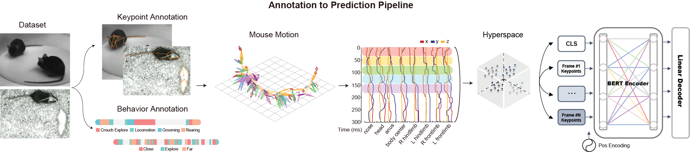
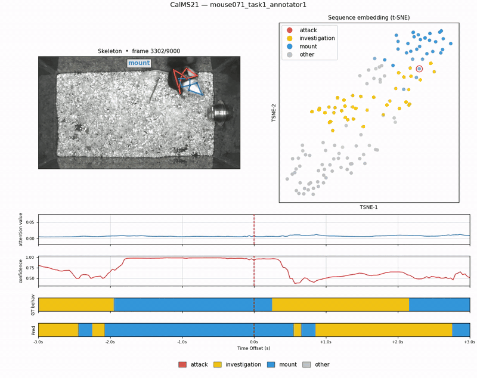
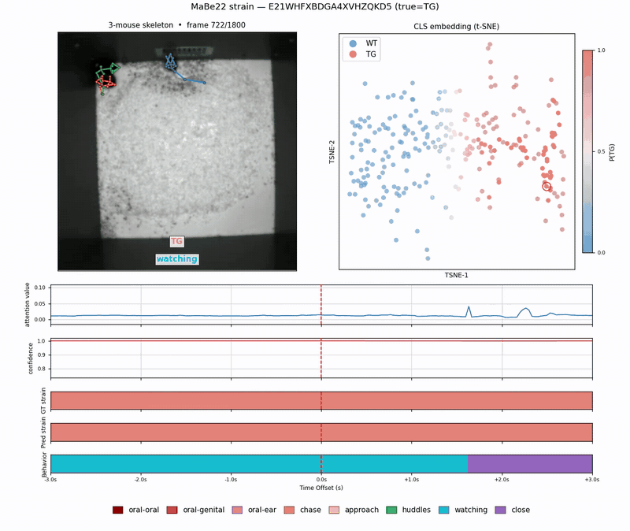
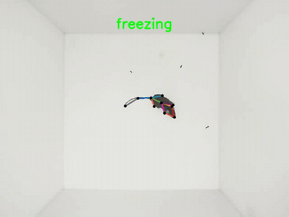
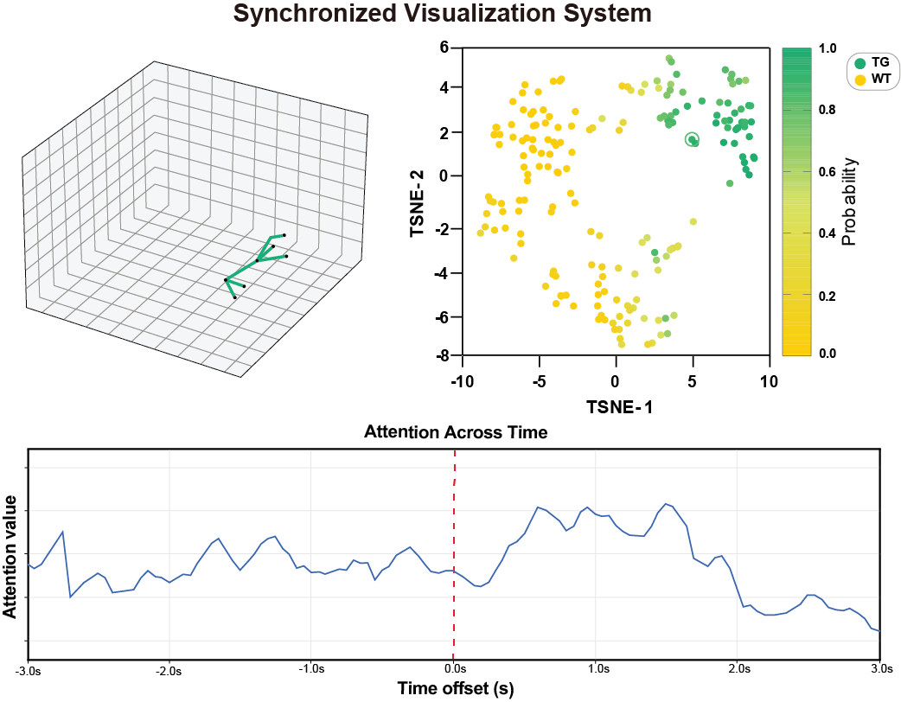
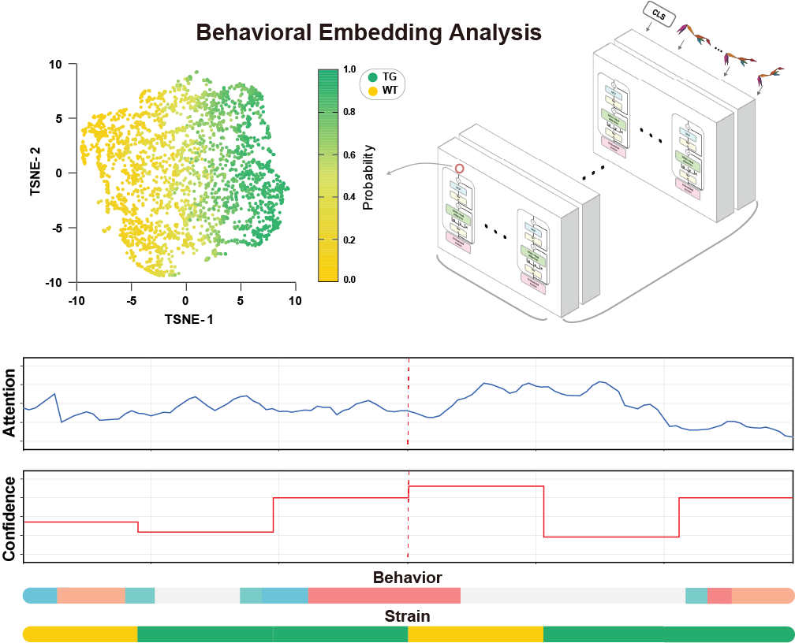
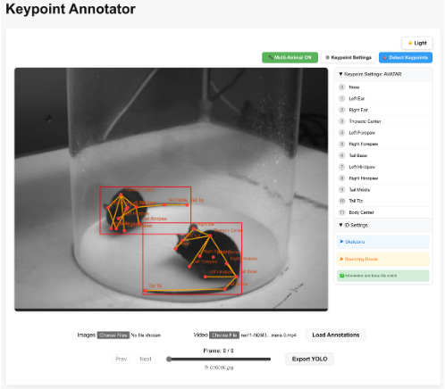
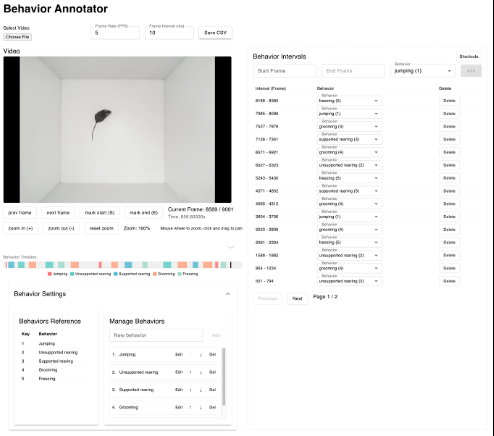

<h1 align="center">BehaVERT</h1>

<p align="center">
  <b>A Transformer-Based Motion Language Model for Decoding Behavioral Semantics in Mice</b>
</p>

<p align="center">
  <a href="https://doi.org/10.1007/s11263-026-02834-y"></a>
  <a href="https://huggingface.co/ShinSeungJ/behavert"></a>
  <a href="https://huggingface.co/datasets/ShinSeungJ/behavert-data"></a>
  <a href="https://colab.research.google.com/github/ShinSeungJ/BehaVERT/blob/main/notebooks/quickstart.ipynb"></a>
  <a href="LICENSE"></a>
</p>

<p align="center">
  
</p>

BehaVERT reads animal pose as a language. Each video frame's keypoints form one
token, and a BERT encoder learns how those tokens relate across time. The same
encoder serves two kinds of question:

- **What is the animal doing at each moment?** A *token* model labels every frame
  (attack, grooming, rearing, …).
- **What is true of the whole clip?** A *sequence* model reads a `[CLS]` token
  and gives one answer for a window or recording (strain, genotype, time of day, …).

This repository holds everything needed to use BehaVERT: pretrained models, a
one-command pipeline from video to behavior, training configs for every
experiment in the paper, and tools to inspect what the model attends to and how
it organizes behavior in its embedding space.

<table>
  <tr>
    <td align="center" width="50%">
      <a href="assets/videos/calms21_sync.mp4"></a><br>
      <sub><b>CalMS21</b>: frame-level attack / investigation / mount, ground truth vs prediction</sub>
    </td>
    <td align="center" width="50%">
      <a href="assets/videos/mabe22_sync.mp4"></a><br>
      <sub><b>MABe22</b>: strain (WT / TG) of a mouse triplet, with attention peaks highlighted</sub>
    </td>
  </tr>
</table>
<p align="center"><sub>Click a preview for the full video. Each panel shows the skeleton on the video, the clip's position in
the embedding map, attention and confidence over ±3 s, and the label strips.</sub></p>

## Contents

- [Installation](#installation)
- [Quick start](#quick-start)
- [Pretrained models](#pretrained-models)
- [Datasets](#datasets)
- [Training and evaluation](#training-and-evaluation)
- [Training on your own data](#training-on-your-own-data)
- [Attention and embedding analysis](#attention-and-embedding-analysis)
- [Annotation tools](#annotation-tools)
- [Repository layout](#repository-layout)
- [Citation](#citation)
- [License](#license)

## Installation

```bash
git clone https://github.com/ShinSeungJ/BehaVERT.git
cd BehaVERT
pip install -e .              # core: models, training, analysis
pip install -e ".[video]"     # + reading and writing videos (OpenCV)
pip install -e ".[pose]"      # + pose estimation from raw video (Ultralytics YOLO)
```

BehaVERT needs Python ≥ 3.9 and PyTorch ≥ 2.3. A CUDA GPU is recommended for
training; inference on short clips also runs on a CPU. Everything is available
through one command, `behavert` (`behavert <command> -h` lists the options).

> [!NOTE]
> The `pose` extra installs [Ultralytics](https://github.com/ultralytics/ultralytics),
> which is licensed under AGPL-3.0, as are the pose models trained with it. The
> rest of BehaVERT is MIT-licensed and does not need it.

## Quick start

Models are downloaded from the Hugging Face Hub on first use. The demo inputs
are in [`demo_data/`](demo_data): videos in `demo_data/video/`, keypoints and labels in `demo_data/keypoints/`.
The [quick-start notebook](notebooks/quickstart.ipynb)
([Colab](https://colab.research.google.com/github/ShinSeungJ/BehaVERT/blob/main/notebooks/quickstart.ipynb))
walks through the same steps.

### From video to behavior



With a pose model in front of it, BehaVERT goes from a raw video to frame-level
behavior in one command. For single mice filmed from above in an open field,
the `oft-pose` and `oft-behavior` models detect 12 keypoints and classify seven
behaviors: supported rearing, unsupported rearing, grooming, freezing, jumping,
backwards walking and others.

```bash
behavert decode --video demo_data/video/oft.mp4 --model oft-behavior --overlay --sync
```

`--video` also takes a folder, and every video in it is processed.

<br clear="right">

Results go to `outputs/decode/<video name>/`:

| File | Contents |
|---|---|
| `keypoints.csv` | the keypoints the model reads, per frame (when they come from a video) |
| `behavior.csv` | per frame: behavior, confidence, attention and the probability of every class |
| `summary.csv` | per behavior: frames, seconds, percent of the recording and number of episodes |
| `analysis.npz` | all of the above, plus one embedding per window |
| `overlay.mp4` | the video with the skeleton and the current behavior drawn on (`--overlay`) |
| `sync.mp4` | synchronized panel: video, embedding map, attention, confidence, labels (`--sync`) |

Each stage is cached: running the command again with other rendering options
reuses the keypoints and predictions (`--force` recomputes them).

### From keypoints to a synchronized video



When keypoints already exist, pass them as a CSV, one row per frame. Ground-truth
labels, if given, are drawn beside the predictions.

```bash
# CalMS21: attack / investigation / mount per frame
behavert decode --keypoints demo_data/keypoints/calms21_mouse071_task1_annotator1.csv \
    --labels demo_data/keypoints/calms21_mouse071_task1_annotator1_labels.csv \
    --video demo_data/video/calms21_mouse071_task1_annotator1.mp4 \
    --model calms21-task1 --sync --frames 9000

# MABe22: strain of a mouse triplet
behavert decode --keypoints demo_data/keypoints/mabe22_E21WHFXBDGA4XVHZQKD5.csv \
    --labels demo_data/keypoints/mabe22_E21WHFXBDGA4XVHZQKD5_labels.csv \
    --video demo_data/video/mabe22_E21WHFXBDGA4XVHZQKD5.mp4 \
    --model mabe22-strain --sync --frames 1800
```

With a benchmark downloaded (see [Datasets](#datasets)), a recording can be named
directly from its training config. The ground truth then comes from the dataset,
and for MABe22 the video also shows the annotated behaviors and places the clip
among other videos of the dataset in the embedding map:

```bash
behavert decode --config configs/mabe22/state.yaml --task strain --recording E21WHFXBDGA4XVHZQKD5 \
    --model mabe22-strain --video demo_data/video/mabe22_E21WHFXBDGA4XVHZQKD5.mp4 --sync --frames 1800
```

<br clear="right">

### In Python

```python
from behavert import BehaVERT
from behavert.inference import predict_recording

model = BehaVERT.from_pretrained("calms21-task1")
pred = predict_recording(model, keypoints)   # keypoints: [frames, animals, keypoints, (x, y)]
pred.labels                                  # one class per frame
pred.probs                                   # [frames, classes]
model.config.label_names                     # ['attack', 'investigation', 'mount', 'other']
```

Each model's `config.json` records its classes, keypoint layout and
preprocessing, and `model(x, output_attentions=True)` returns logits,
embeddings and attention maps.

## Pretrained models

| &nbsp;&nbsp;&nbsp;&nbsp;&nbsp;&nbsp;&nbsp;&nbsp;&nbsp;&nbsp;&nbsp;&nbsp;Model&nbsp;&nbsp;&nbsp;&nbsp;&nbsp;&nbsp;&nbsp;&nbsp;&nbsp;&nbsp;&nbsp;&nbsp; | Task | Input | Output | License |
|---|---|---|---|---|
| [`calms21-task1`](https://huggingface.co/ShinSeungJ/behavert/tree/main/calms21-task1) | CalMS21 Task 1, resident–intruder | 2 mice × 7 keypoints | attack / investigation / mount / other, per frame | MIT |
| [`mabe22-strain`](https://huggingface.co/ShinSeungJ/behavert/tree/main/mabe22-strain) | MABe22 mouse triplets | 3 mice × 12 keypoints | strain, WT or TG, per window and per video | MIT |
| [`oft-behavior`](https://huggingface.co/ShinSeungJ/behavert/tree/main/oft-behavior) | open field, top view | 1 mouse × 11 keypoints | 7 behaviors, per frame | MIT |
| [`oft-pose`](https://huggingface.co/ShinSeungJ/behavert-pose/tree/main/oft-pose) | pose estimation for `oft-behavior` | video | 12 keypoints, 1 mouse | AGPL&#8209;3.0 |
| [`sbea-pose`](https://huggingface.co/ShinSeungJ/behavert-pose/tree/main/sbea-pose) | pose estimation for SBeA recordings | video | 12 keypoints, 2 mice | AGPL&#8209;3.0 |

The short names work in every command and in `BehaVERT.from_pretrained`. Local
checkpoint folders and other Hub repos work too. The model cards
([behavior](https://huggingface.co/ShinSeungJ/behavert),
[pose](https://huggingface.co/ShinSeungJ/behavert-pose)) describe the inputs and
test-set scores of each model.

## Datasets

All five benchmarks from the paper, prepared for BehaVERT, are on the Hugging Face Hub
([`ShinSeungJ/behavert-data`](https://huggingface.co/datasets/ShinSeungJ/behavert-data)).
Download them into `dataset/`, where every command looks by default:

```bash
behavert download                    # all five benchmarks, about 12 GB
behavert download calms21 mabe22     # or only the ones you need
```

| Benchmark | Animals | Keypoints | Tasks | Size |
|---|---|---|---|---|
| [CalMS21](https://huggingface.co/datasets/ShinSeungJ/behavert-data/blob/main/calms21/README.md) | 2 mice, 2D | 7 per mouse | Task 1 behaviors, Task 3 new behaviors, pretraining | 4.8&nbsp;GB |
| [MABe22](https://huggingface.co/datasets/ShinSeungJ/behavert-data/blob/main/mabe22/README.md) | 3 mice, 2D | 12 per mouse | strain, lights, experiment day, time of day, 9 behaviors | 3.6&nbsp;GB |
| [PAIR-R24M](https://huggingface.co/datasets/ShinSeungJ/behavert-data/blob/main/pair24m/README.md) | 1–2 rats, 3D | 12 per rat | single-animal behavior, social interaction | 2.1&nbsp;GB |
| [DeepEthogram](https://huggingface.co/datasets/ShinSeungJ/behavert-data/blob/main/deepethogram/README.md) | 1 mouse, 2D | 11 (our YOLOv12 predictions) | 6 behaviors | 1.4&nbsp;GB |
| [SBeA](https://huggingface.co/datasets/ShinSeungJ/behavert-data/blob/main/sbea/README.md) | 2 mice, 3D | 16 per mouse | genotype pair, behavior (our annotations) | 0.3&nbsp;GB |

Every benchmark folder already contains a short `sample.mp4` from that dataset,
so you can see what the recordings look like before downloading. The download
adds the data and a README per benchmark next to it. See
[`dataset/README.md`](dataset/README.md) for the layout, licenses and the
original papers to cite.

## Training and evaluation

Each experiment in the paper has a YAML config in [`configs/`](configs). Training
runs on the train / validation split, keeps the best checkpoints and finishes by
scoring them on the test set:

```bash
behavert train configs/calms21/task1.yaml
```

Configs that cover several related tasks list them under `tasks:` and take `--task`:

```bash
behavert train configs/mabe22/behavior.yaml --task chase
behavert train configs/mabe22/state.yaml --task strain
```

Any setting can be changed from the command line with `--set`:

```bash
behavert train configs/deepethogram/behavior.yaml --set train.epochs=50 data.augmentation.enabled=false
```

A run writes to its config's `output_dir` (e.g. `outputs/calms21/task1/`):

| Path | Contents |
|---|---|
| `best_f1/` (or `best_f1_class1/`), `best_loss/`, `last/` | checkpoints (`config.json` + `model.safetensors`), loadable with `from_pretrained` |
| `history.jsonl` | training and validation metrics per evaluation |
| `test_results.json` | test-set scores of each checkpoint |
| `config.yaml` | the exact configuration of the run |

To score any checkpoint, released or your own, on a config's test set:

```bash
behavert evaluate configs/mabe22/state.yaml mabe22-strain --task strain
behavert evaluate configs/calms21/task1.yaml outputs/calms21/task1/best_f1
```

## Training on your own data

Two templates cover your own keypoints:

- [`configs/custom_token.yaml`](configs/custom_token.yaml): one behavior label per frame.
- [`configs/custom_state.yaml`](configs/custom_state.yaml): one label per recording, such
  as a genotype or a treatment. Each test recording is classified from its windows.

The simplest input is a folder with one CSV per recording: one row per frame,
keypoint coordinates as columns and a `label` column with class names or numbers.

```text
nose_x,nose_y,left_ear_x,left_ear_y,...,label
0.512,0.344,0.498,0.330,...,walk
0.515,0.341,0.501,0.329,...,walk
```

Rows with an empty label are not scored. For one label per recording, repeat it on
every row and use `custom_state.yaml`. Set the class names, window length and number
of epochs in the template, then:

```bash
behavert train configs/custom_token.yaml --data-root /path/to/your/data
behavert decode --keypoints new_session.csv --model outputs/custom_token/best_f1 --video new_session.mp4 --sync
```

Keypoints can also be given as one `.pt`, `.pkl` or `.npz` file holding every
recording. The templates explain both formats, data splits and augmentation.

## Attention and embedding analysis

Two commands run the paper's analyses over a whole dataset, with a released or a
newly trained checkpoint.



**Embeddings.** `behavert embed` projects the embeddings of a dataset's
recordings (one per frame for token models, one per window for sequence models)
to 2D with t-SNE or UMAP. It plots them colored by class and measures how well
they separate the classes:

```bash
behavert embed configs/calms21/task1_pretrained.yaml calms21-task1
behavert embed configs/mabe22/state.yaml mabe22-strain --task strain --method umap
```

Output: `embedding.csv` (coordinates, true and predicted class of every point),
`clustering.csv` (NMI, purity, accuracy and F1 of the predictions and of k-means
clusters), and `embedding.png` / `.svg` / `.pdf` with editable text.

**Attention.** `behavert attention` records, for every window, how attention is
spread over its frames, and relates it to the model's confidence, its correctness
and the behaviors taking place:

```bash
behavert attention configs/mabe22/state.yaml mabe22-strain --task strain --split test
```

<br clear="right">

| Output | Contents |
|---|---|
| `attention_frames.csv` | attention on every frame of every window, with behavior labels when available |
| `attention_windows.csv` | per window: prediction, confidence, correctness, mean and peakedness of attention |
| `attention_tests.csv` | statistical comparisons between confidence, correctness and attention peakedness |
| `behavior_attention.csv` | attention on frames with and without each behavior |
| `behavior_peaks.csv` | how often each behavior occurs at attention peaks vs elsewhere |
| `behavior_success_failure.csv` | attention on each behavior in confident correct vs confident wrong windows |

Both commands default to the test split. They take `--split` and
`--recordings N` to choose the data, and `--out` for the output folder.

## Annotation tools

Two browser-based tools from the paper for labeling training data. They need
no installation.

<table>
  <tr>
    <td align="center" width="50%">
      <a href="https://shinseungj.github.io/annotator/"></a><br>
      <b><a href="https://shinseungj.github.io/annotator/">Keypoint Annotator</a></b><br>
      <sub>Keypoints and bounding boxes on video frames, for one or several animals, exported for YOLO pose training</sub>
    </td>
    <td align="center" width="50%">
      <a href="https://shinseungj.github.io/behavior-annotator/"></a><br>
      <b><a href="https://shinseungj.github.io/behavior-annotator/">Behavior Annotator</a></b><br>
      <sub>Behavior intervals on a video timeline with keyboard shortcuts, exported as CSV</sub>
    </td>
  </tr>
</table>

## Repository layout

```text
BehaVERT/
├── behavert/              Python package
│   ├── model.py             BehaVERT encoder with token and sequence heads
│   ├── data/                recording loaders, windows, augmentation
│   ├── training.py          training loop; losses.py, metrics.py
│   ├── pretraining.py       masked keypoint modeling
│   ├── inference.py         prediction on whole recordings
│   ├── attention.py         attention analysis
│   ├── clustering.py        embedding maps and clustering metrics
│   ├── decode/              video / keypoints -> behavior -> rendered videos
│   └── cli.py               the `behavert` command
├── configs/               one YAML per experiment, plus custom_token.yaml and custom_state.yaml
├── dataset/               benchmark data (`behavert download`) and sample videos
├── demo_data/             demo videos (video/) and keypoints with labels (keypoints/)
├── notebooks/             quick-start notebook
├── scripts/               checkpoint conversion
└── assets/                figures and videos for this README
```

## Citation

If you use BehaVERT, please cite:

```bibtex
@article{shin2026behavert,
  title   = {BehaVERT: A Transformer-Based Motion Language Model for Decoding Behavioral Semantics in Mice},
  author  = {Shin, Seung Jae and Lee, Junesu and Ko, Chang and Kim, Daesoo},
  journal = {International Journal of Computer Vision},
  volume  = {134},
  pages   = {303},
  year    = {2026},
  doi     = {10.1007/s11263-026-02834-y}
}
```

When you use one of the benchmarks or a model trained on it, please also cite
the original dataset: CalMS21 (Sun et al., NeurIPS 2021 Datasets and Benchmarks),
MABe22 (Sun et al., ICML 2023), PAIR-R24M (Marshall et al., NeurIPS 2021 Datasets
and Benchmarks), DeepEthogram (Bohnslav et al., eLife 2021) or SBeA (Han et al.,
Nature Machine Intelligence 2024). Full references are in
[`dataset/README.md`](dataset/README.md).

## License

- **Code:** [MIT](LICENSE).
- **Behavior models** (`ShinSeungJ/behavert`): MIT.
- **Pose models** (`ShinSeungJ/behavert-pose`) and the optional Ultralytics
  dependency: AGPL-3.0.
- **Datasets:** our own annotations and keypoints are CC BY 4.0, and data derived
  from the original benchmarks follows their terms. See [`dataset/README.md`](dataset/README.md).
